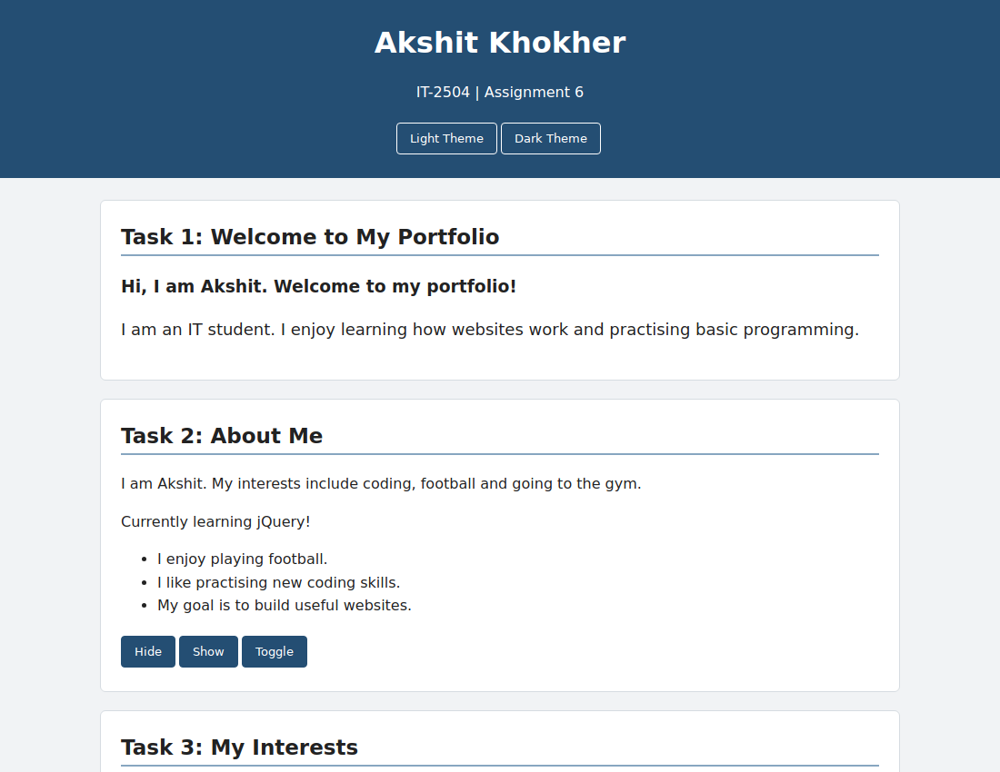
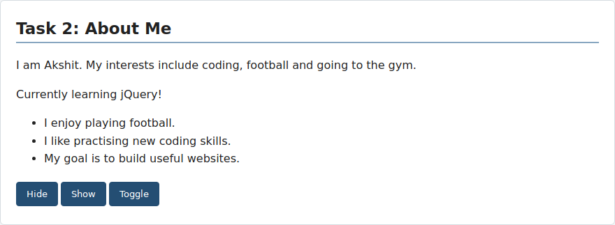
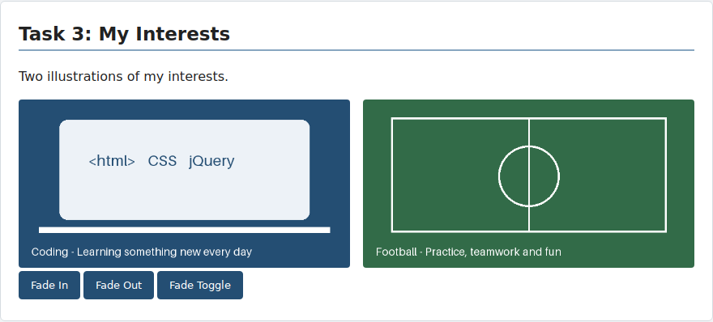
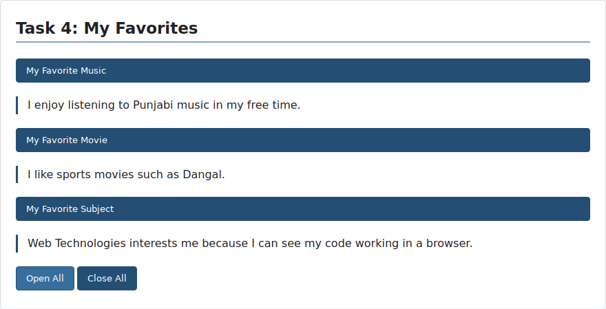
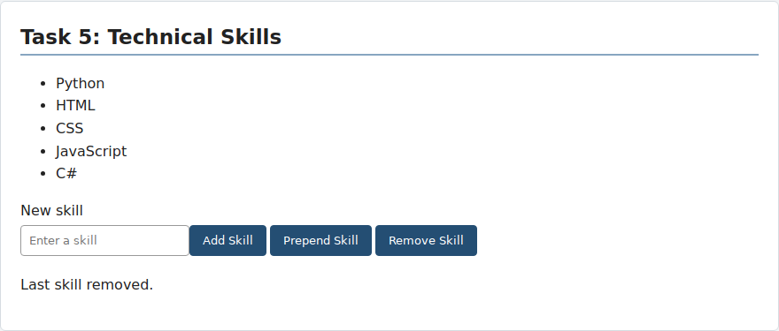
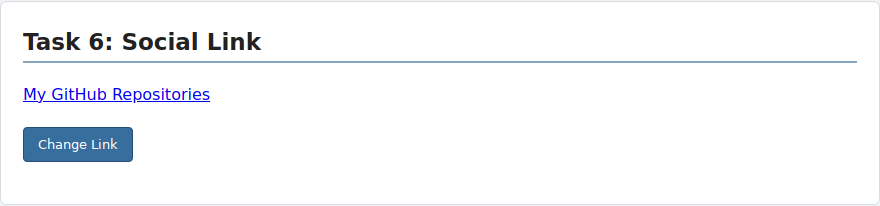
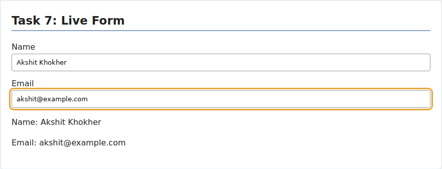
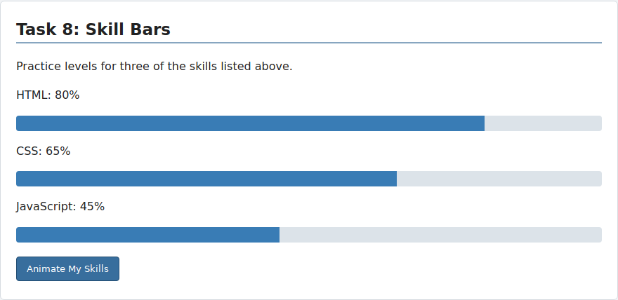

# Assignment 6 — jQuery Portfolio

**Name:** Akshit Khokher  
**Group:** IT-2504

## Part 1 — Getting Started with jQuery

### Task 0 — Setup

The HTML loads jQuery from a CDN before `script.js`. The document-ready function prints `jQuery is ready!` in the browser console. Open Developer Tools → Console to see it.

### Task 1 — Selectors and CSS

The page displays my name, introduction and portfolio title. The `h2` tag selector adds a border, `#headline` changes the greeting with `.text()`, and `.intro` changes the font size with `.css()`. The theme buttons add or remove the dark class.

## Part 2 — jQuery Effects

### Task 2 — Visibility Methods

Hide, Show and Toggle control the status and fun facts using `.hide()`, `.show()` and `.toggle()`.

### Task 3 — Fade Methods

Two local PNG illustrations show coding and football. The three buttons use `.fadeIn()`, `.fadeOut()` and `.fadeToggle()` on both images.

### Task 4 — Slide Methods

Each of the three favorite headings uses `.slideToggle()` for its panel. Open All uses `.slideDown()` and Close All uses `.slideUp()`.

## Part 3 — DOM Manipulation

### Task 5 — Add and Remove Elements

The initial skills are HTML, CSS, JavaScript and C#. Add Skill appends a new item, Prepend Skill inserts it first, and Remove Skill removes the last item. Whitespace-only inputs are rejected. New skill text is inserted with `.text()`.

### Task 6 — Modifying Attributes

Change Link switches between my GitHub profile and its repositories tab using `.attr("href", ...)`. The visible link text changes too.

### Task 7 — Form Interaction

The input event reads Name and Email with `.val()` and updates the live preview using `.text()`. The form is a local demonstration and does not send data.

## Part 4 — Animations

### Task 8 — Basic Animation

Three bars represent HTML, CSS and JavaScript from the skills list. They start at zero width. Animate My Skills uses `.animate()` to reach 80%, 65% and 45%. Clicking again animates all bars back to zero. These percentages are demonstration values.

## Files

- `index.html` — page content and CDN setup
- `style.css` — layout, themes and skill bars
- `script.js` — task functions
- `images/` — two local gallery illustrations
- `screenshots/` — task screenshots for this report

